<picture>
  <source media="(prefers-color-scheme: dark)" srcset="./assets/header-dark.svg" />
  
</picture>

[ORCID](https://orcid.org/0009-0004-7519-197X) · [LinkedIn](https://www.linkedin.com/in/reed-naidoo-02329a223/) · [Hugging Face](https://huggingface.co/Sentinal4D) · [Sentinal4D](https://www.sentinal4d.com)

## About

I am a PhD researcher at [The Institute of Cancer Research](https://www.icr.ac.uk/) in [Professor Chris Bakal's](https://www.icr.ac.uk/our-research/researchers-and-teams/professor-chris-bakal) Dynamical Cell Systems lab, and a Research Scientist at [Sentinal4D](https://www.sentinal4d.com), an ICR spin-out building predictive models of living cells for drug discovery.

My work starts from a simple idea: **cell shape is a functional readout, not just a proxy**. I build generative and representation-learning models that learn how 3D cell morphology responds to genetic and chemical perturbation, and use them to predict, simulate and interpret those responses.

My PhD is funded by an [NIHR BRC Studentship](https://www.maudsleybrc.nihr.ac.uk/). Previously I studied mathematical statistics in South Africa and completed an MSc in Data Science at the University of Bath.

## Research

- **Generative virtual cells.** Diffusion models that simulate how 3D cell morphology changes under perturbation, and what those changes reveal about mechanism.
- **Cross-modal translation.** Linking cell images to transcriptomics and other modalities, so imaging can stand in for costlier assays.
- **Coming soon.**

## Publications

**2026**

- **Coming soon.**   **R. Naidoo** et al. *NeurIPS 2026.*
- **Cell Painting Generates Single-Cell Transcriptomics via Conditional Diffusion.**   **R. Naidoo**, J. Hu, G. Tripodi, C. Bakal, T. Chakraborti. *ICML 2026 Workshop on Foundation Models for Life Sciences.*   [Paper](https://openreview.net/forum?id=ACHMa1e8J1) · [Code](https://github.com/reednaidoo/PhenoSeq) · [Model](https://huggingface.co/Sentinal4D/PhenoSeq)

**2025**

- **Morphologically Intelligent Perturbation Prediction with FORM.**   **R. Naidoo**, M. De Vries, O. Fourkioti, V. Bousgouni, M. Arias-Garcia, M. Portillo-Malumbres, C. Bakal. *arXiv preprint.*   [Paper](https://arxiv.org/abs/2510.21337)
- **Interpretable Point Cloud Classification Using Multiple Instance Learning.**   M. De Vries, **R. Naidoo**, O. Fourkioti, L. G. Dent, N. Curry, C. Dunsby, C. Bakal. *ICCV 2025.*   [Paper](https://openaccess.thecvf.com/content/ICCV2025/html/De_Vries_Interpretable_point_cloud_classification_using_multiple_instance_learning_ICCV_2025_paper.html)
- **Geometric Deep Learning and Multiple-Instance Learning for 3D Cell-Shape Profiling.**   M. De Vries, L. G. Dent, N. Curry, L. Rowe-Brown, V. Bousgouni, O. Fourkioti, **R. Naidoo**, H. Sparks, A. Tyson, C. Dunsby, C. Bakal. *Cell Systems.*   [Paper](https://repository.icr.ac.uk/items/376ed8e5-66c7-4a4a-8255-8bc8ae187b46)

**2024**

- **SurvivMIL: A Multimodal, Multiple Instance Learning Pipeline for Survival Outcome of Neuroblastoma Patients.**   **R. Naidoo**, O. Fourkioti, M. De Vries, C. Bakal. *MICCAI 2024 Workshop on Computational Pathology (PMLR 254).*   [Paper](https://proceedings.mlr.press/v254/naidoo24a.html)
- **Interpretable Phenotypic Profiling of 3D Cellular Morphodynamics.**   M. De Vries, **R. Naidoo**, O. Fourkioti, L. G. Dent, N. Curry, C. Dunsby, C. Bakal. *MICCAI 2024.*   [Paper](https://papers.miccai.org/miccai-2024/418-Paper3839.html)

## Code and models

| Project | Description | Links |
|:--|:--|:--|
| **PhenoSeq** | Conditional diffusion model that generates single-cell transcriptomic (scGPT) embeddings from Cell Painting features | [GitHub](https://github.com/reednaidoo/PhenoSeq) · [Hugging Face](https://huggingface.co/Sentinal4D/PhenoSeq) |
| **NOVA** | Vector-quantised transformer for microscopy with biological graph priors | Coming soon |

---

London, UK · Open to collaborations at the interface of machine learning and cell biology · [Get in touch](https://www.linkedin.com/in/reed-naidoo-02329a223/)
