  

  
  
  
  
  

 

### About

I am a PhD researcher at [The Institute of Cancer Research](https://www.icr.ac.uk/) in [Professor Chris Bakal's](https://www.icr.ac.uk/our-research/researchers-and-teams/professor-chris-bakal) Dynamical Cell Systems lab, and a Research Scientist at [Sentinal4D](https://www.sentinal4d.com), an ICR spin-out building predictive models of living cells for drug discovery.

My work starts from a simple idea: **cell shape is a functional readout, not just a proxy**. I build generative and representation-learning models that learn how 3D cell morphology responds to genetic and chemical perturbation, and use them to predict, simulate and interpret those responses.

My PhD is funded by an [NIHR BRC Studentship](https://www.maudsleybrc.nihr.ac.uk/). Previously I studied mathematical statistics in South Africa and completed an MSc in Data Science at the University of Bath.

 

### News

| | |
|:--|:--|
| `Sep 2026` | **NOVA** accepted at **NeurIPS 2026**. Paper and code coming soon. |
| `Sep 2026` | Shortlisted for BioUK Emerging Entrepreneur of the Year. |
| `Jul 2026` | Presented **PhenoSeq** at the ICML 2026 FM4LS workshop. Code and weights are public. |
| `Oct 2025` | **FORM** preprint released on [arXiv](https://arxiv.org/abs/2510.21337). |
| `Oct 2025` | Interpretable point cloud MIL paper presented at **ICCV 2025**. |

 

### Research

<table>
<tr>
<td width="33%" valign="top">

**Generative virtual cells** 
Diffusion models that simulate how 3D cell morphology changes under perturbation, and what those changes reveal about mechanism.

</td>
<td width="33%" valign="top">

**Biologically grounded representations** 
Self-supervised microscopy models regularised with prior knowledge of protein complexes and pathways.

</td>
<td width="33%" valign="top">

**Cross-modal translation** 
Linking cell images to transcriptomics and other modalities, so imaging can stand in for costlier assays.

</td>
</tr>
</table>

 

### Publications

Full list on <a href="https://scholar.google.com/citations?user=YOUR_SCHOLAR_ID">Google Scholar</a>.

 &nbsp;**Biological Graph Priors Enable Representation Learning for Cellular Microscopy** 
**R. Naidoo** et al. 
`Coming soon`

 &nbsp;**Cell Painting Generates Single-Cell Transcriptomics via Conditional Diffusion** 
**R. Naidoo**, J. Hu, G. Tripodi, C. Bakal, T. Chakraborti. *ICML 2026 Workshop on Foundation Models for Life Sciences (FM4LS)* 
[Paper](https://openreview.net/forum?id=ACHMa1e8J1) · [Code](https://github.com/reednaidoo/PhenoSeq) · [Model](https://huggingface.co/Sentinal4D/PhenoSeq)

 &nbsp;**Morphologically Intelligent Perturbation Prediction with FORM** 
**R. Naidoo**, M. De Vries, O. Fourkioti, V. Bousgouni, M. Arias-Garcia, M. Portillo-Malumbres, C. Bakal 
[Paper](https://arxiv.org/abs/2510.21337)

 &nbsp;**Interpretable Point Cloud Classification Using Multiple Instance Learning** 
M. De Vries, **R. Naidoo**, O. Fourkioti, L. G. Dent, N. Curry, C. Dunsby, C. Bakal 
[Paper](https://openaccess.thecvf.com/content/ICCV2025/html/De_Vries_Interpretable_point_cloud_classification_using_multiple_instance_learning_ICCV_2025_paper.html)

 &nbsp;**Geometric Deep Learning and Multiple-Instance Learning for 3D Cell-Shape Profiling** 
M. De Vries, L. G. Dent, N. Curry, L. Rowe-Brown, V. Bousgouni, O. Fourkioti, **R. Naidoo**, H. Sparks, A. Tyson, C. Dunsby, C. Bakal 
[Paper](https://repository.icr.ac.uk/items/376ed8e5-66c7-4a4a-8255-8bc8ae187b46)

 &nbsp;**Interpretable Phenotypic Profiling of 3D Cellular Morphodynamics** 
M. De Vries, **R. Naidoo**, O. Fourkioti, L. G. Dent, N. Curry, C. Dunsby, C. Bakal 
[Paper](https://papers.miccai.org/miccai-2024/418-Paper3839.html) · [DOI](https://doi.org/10.1007/978-3-031-72117-5_45)

 

### Code and models

| Project | Description | Links |
|:--|:--|:--|
| **PhenoSeq** | Conditional diffusion model that generates single-cell transcriptomic (scGPT) embeddings from Cell Painting features | [GitHub](https://github.com/reednaidoo/PhenoSeq) · [Hugging Face](https://huggingface.co/Sentinal4D/PhenoSeq) |
| **NOVA** | Vector-quantised transformer for microscopy with biological graph priors | `Coming soon` |

 

### Toolkit

PyTorch · Lightning · Diffusion and flow models · Vision transformers · Geometric deep learning · Google Cloud · 3D and time-lapse microscopy

 

---

  London, UK · Open to collaborations at the interface of machine learning and cell biology · <a href="https://www.linkedin.com/in/reed-naidoo-02329a223/">Get in touch</a>

